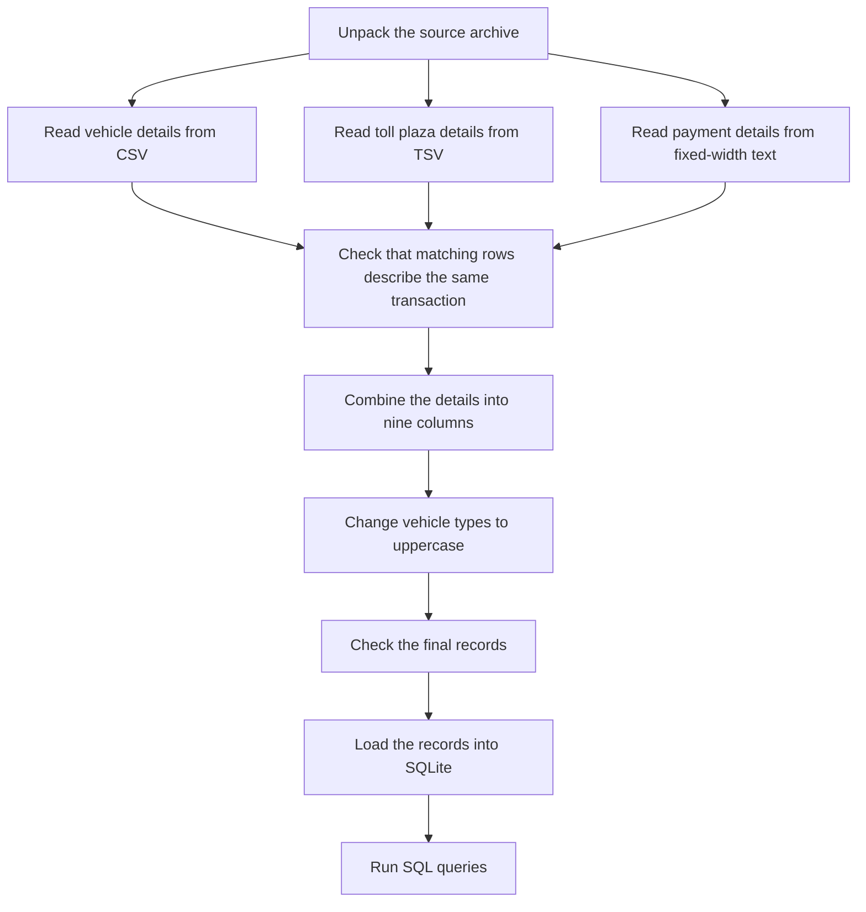
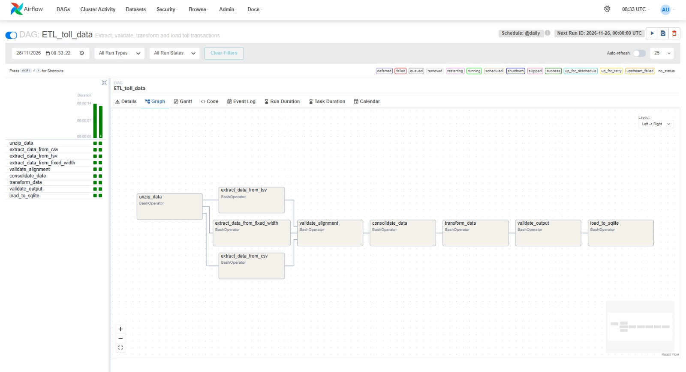
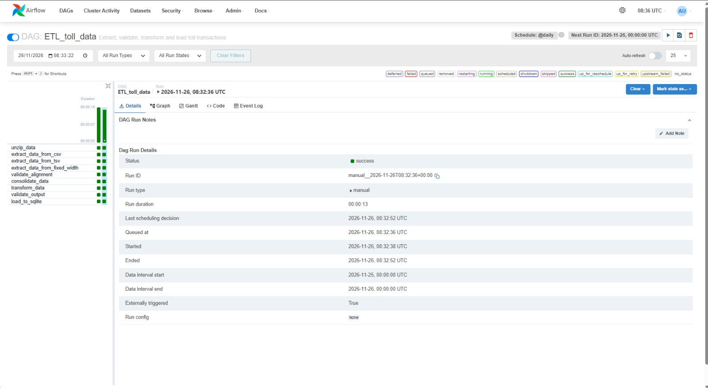
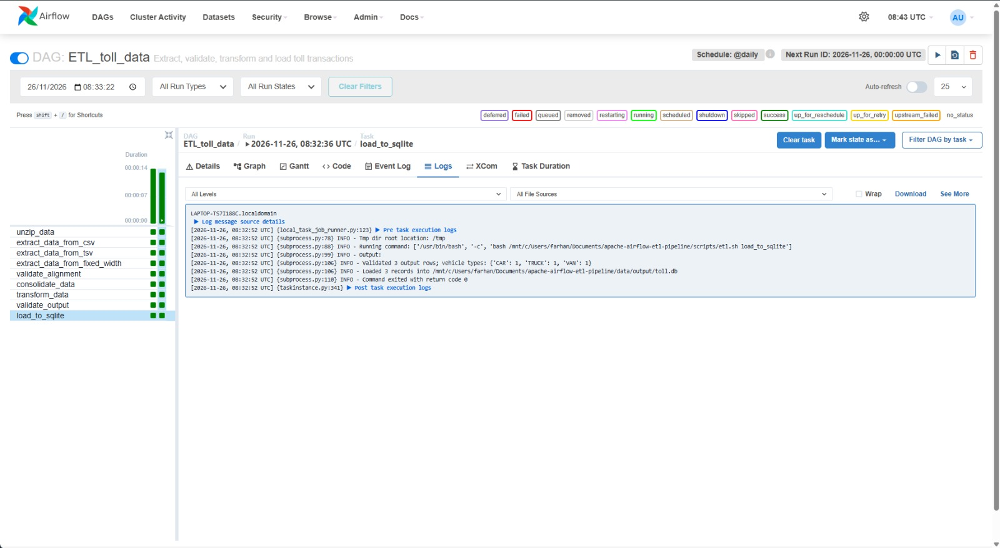

# Toll Data ETL Pipeline with Apache Airflow

A data engineering project that reads toll-road records from three file formats, combines them, checks for errors, and saves them in a SQLite database for SQL analysis.

I built this project to practise data engineering skills and prepare for a data internship. It started from an IBM Skills Network course lab and was extended with data checks, database loading, automated tests, and a way to run the processing without Airflow.

**Tools:** Apache Airflow, Python, Bash, SQLite, SQL, and GitHub Actions.

## What problem does this solve?

Details about a toll transaction are spread across three files. One contains vehicle details, another contains toll plaza details, and the third contains payment details. Each file uses a different layout.

The pipeline brings those details together into one record per transaction. After loading the records into a database, SQL queries can answer questions such as:

- How many transactions involved cars, trucks, or vans?
- How much toll traffic was recorded each day?
- Which toll plazas had the most transactions?
- Which payment codes appeared most often?

## How it works

**ETL** means **Extract, Transform, Load**: read useful data, prepare it, and save it somewhere it can be queried.



There are nine processing tasks:

1. Unpack `tolldata.tgz` to get the three input files.
2. Extract vehicle fields from the CSV file.
3. Extract toll plaza fields from the TSV file.
4. Extract payment fields from the fixed-width file.
5. Check that the rows in all three files match correctly.
6. Combine the fields into complete records.
7. Standardise vehicle types, for example `car` becomes `CAR`.
8. Check the final records for errors.
9. Load the records into the `toll_transactions` database table.

The loading step also converts dates into a consistent format, such as `2026-01-05 12:00:01`.

## What each tool does

| Tool | Role in this project |
|---|---|
| Apache Airflow 2.10.5 | Schedules the work, controls task order, and records task status and logs |
| Python 3.11 | Defines the workflow, checks data, generates sample files, and loads the database |
| Bash | Runs the commands for each processing step |
| Linux tools | `tar` unpacks files, `cut` selects fields, `tr` changes separators, `paste` combines rows, and `awk` uppercases vehicle types |
| SQLite | Stores the final records in a local database file |
| SQL | Groups and counts records to answer questions about toll traffic |
| Python unittest | Tests successful runs, repeat runs, and rejection of incorrect data |
| GitHub Actions | Is configured to run tests and Python syntax checks on pushes and pull requests |

Airflow coordinates the steps. Bash and Python do the actual data processing.

## Input files and final data

| Input file | Format | Details taken from it |
|---|---|---|
| `vehicle-data.csv` | CSV: values separated by commas | Transaction ID, timestamp, anonymised vehicle number, and vehicle type |
| `tollplaza-data.tsv` | TSV: values separated by tabs | Axle count, toll plaza ID, and toll plaza code |
| `payment-data.txt` | Fixed-width: fields occupy set character positions | Payment code and vehicle code |

The input and generated CSV files have no header row. The SQLite table names all nine final columns:

| Column | Meaning |
|---|---|
| `row_id` | Unique transaction ID; the table's primary key |
| `event_timestamp` | Transaction date and time; the source does not specify a timezone |
| `vehicle_number` | Anonymised vehicle identifier |
| `vehicle_type` | `CAR`, `TRUCK`, or `VAN` |
| `axle_count` | Number of vehicle axles |
| `tollplaza_id` | Toll plaza identifier |
| `tollplaza_code` | Toll plaza accounting code |
| `payment_code` | Payment code from the source file |
| `vehicle_code` | Vehicle category code from the source file |

## How the project checks correctness

The files are combined **by row position**: the first row of one file is combined with the first row of the others. Before combining them, the pipeline checks that the files have the same number of rows and that their shared transaction details match. If the rows are in the wrong order, it stops.

It also checks for duplicate IDs, missing fields, invalid dates, unexpected vehicle types, incorrect extraction or transformation, and invalid numeric values.

Each load replaces the existing records inside a **database transaction**. Running the same input again does not add duplicates. If the replacement fails, the database changes are rolled back.

## How Airflow runs the project

An Airflow **DAG** is a map of tasks and the order in which they run. The three extraction tasks can run in parallel. Combining the data must wait until all three extractions and the matching check succeed.

The DAG is configured to:

- Run once a day.
- Retry a failed task once after five minutes.
- Allow only one active run at a time because tasks share local files.
- Skip automatically creating runs for past dates (`catchup=False`).

Each scheduled run reprocesses the archive already in `data/raw/`. Collecting new daily files and loading only new records would require additional work.

## Results and screenshots

There are two separate sets of results:

| Check | Dataset | Result |
|---|---|---|
| Local Bash/Python run | Original course dataset | 10,000 records loaded, nine output columns, no duplicate IDs or empty fields |
| Live local Airflow run | Three generated sample transactions | All nine tasks succeeded; three records were validated and loaded into SQLite |

For the original dataset, the cleaned CSV exactly matched the original lab output, and the SQLite integrity check returned `ok`. The data covered 29 July to 22 August 2021: 6,438 cars, 2,368 trucks, and 1,194 vans. The original data is excluded from this repository.

The screenshots below show the **three-record sample run in Airflow**, completed on 26 November 2026. The 10,000-record dataset was checked with the local runner, rather than the Airflow scheduler. See [validation notes](docs/validation.md) for more detail.

### Task dependencies

The graph shows the extraction branches and the checks before loading.



### Successful run

The Grid and run details show green task statuses and a successful DAG run.



### Database loading logs

The logs show three validated rows, three records loaded into SQLite, and return code zero, which means the command completed successfully.



## Project files

| File or folder | What it contains |
|---|---|
| `dags/ETL_toll_data.py` | Airflow tasks, schedule, and dependencies |
| `scripts/etl.sh` | Commands for the nine processing steps |
| `scripts/quality.py` | Data checks and SQLite loading |
| `scripts/make_sample.py` | Creates an archive with three made-up transactions |
| `scripts/run_local.sh` | Runs all steps in order without Airflow |
| `sql/analytics.sql` | Example queries for the final table |
| `tests/test_pipeline.py` | Automated tests |
| `docs/` | Validation notes and screenshots |
| `.github/workflows/tests.yml` | GitHub Actions test configuration |
| `requirements.txt` | The Airflow version used by the project |

## Run without Airflow

Use Linux, macOS, or Ubuntu through WSL on Windows. You need Python 3.11, Bash, and the standard Linux tools listed above. The local runner needs no extra Python packages.

From the project directory, run:

```bash
python3 scripts/make_sample.py
bash scripts/run_local.sh
python3 -m unittest discover -s tests -v
```

The first command creates three sample transactions. If the archive already exists, skip that command and continue with the other two. To use the original dataset, place your authorised `tolldata.tgz` in `data/raw/` instead of generating the sample. It must contain the three expected input filenames at its root.

The outputs are:

- `data/staging/transformed_data.csv`: combined and cleaned data.
- `data/output/toll.db`: the database containing `toll_transactions`.

If the `sqlite3` command is installed, run the example analysis with:

```bash
sqlite3 -header -column data/output/toll.db < sql/analytics.sql
```

On Ubuntu, install that command with `sudo apt install sqlite3` if needed.

## Run Airflow on Windows using WSL

This project uses **Airflow 2.10.5 and Python 3.11** as a fixed learning setup. Run these commands in **Ubuntu**, rather than Windows CMD or PowerShell.

### 1. Install Airflow

Open the project directory. For my Windows checkout, the WSL path is below. Use your own project path if you cloned it elsewhere.

```bash
cd /mnt/c/Users/farhan/Documents/apache-airflow-etl-pipeline
```

Install the basic tools and `uv`, which manages Python environments. Skip installing `uv` if you already have it.

```bash
sudo apt update
sudo apt install -y curl ca-certificates tar coreutils gawk
curl -LsSf https://astral.sh/uv/install.sh | sh
export PATH="$HOME/.local/bin:$PATH"
```

Keep the environment inside Ubuntu's home directory. This avoids the package installation permission problems that can occur under the Windows-mounted `/mnt/c/` directory.

```bash
uv python install 3.11
uv venv --python 3.11 "$HOME/.venvs/toll-airflow"
source "$HOME/.venvs/toll-airflow/bin/activate"

uv pip install -r requirements.txt \
  --constraint https://raw.githubusercontent.com/apache/airflow/constraints-2.10.5/constraints-3.11.txt

airflow version
```

The version command should print `2.10.5`. The constraints file helps install compatible dependency versions. On future visits, activate the existing environment; you do not need to create it again.

### 2. Start the server

Make sure the input archive exists by following the sample-data instructions above. Then run:

```bash
export AIRFLOW_HOME="$HOME/airflow-toll"
export AIRFLOW__CORE__DAGS_FOLDER="$PWD/dags"
export AIRFLOW__CORE__LOAD_EXAMPLES=False
export TOLL_DATA_DIR="$PWD/data"

airflow standalone
```

These settings tell Airflow where to store its own files, where to find the DAG, and where the project data lives.

**Leave this terminal open.** It hosts the local server, so it will not return to the command prompt. Open `http://localhost:8080` and use the login details printed by Airflow. This setup is for local learning.

### 3. Run the DAG from a second terminal

Open another Ubuntu terminal and repeat the directory, activation, and settings:

```bash
cd /mnt/c/Users/farhan/Documents/apache-airflow-etl-pipeline
source "$HOME/.venvs/toll-airflow/bin/activate"

export AIRFLOW_HOME="$HOME/airflow-toll"
export AIRFLOW__CORE__DAGS_FOLDER="$PWD/dags"
export AIRFLOW__CORE__LOAD_EXAMPLES=False
export TOLL_DATA_DIR="$PWD/data"

airflow dags list-import-errors
airflow dags list
```

Once `ETL_toll_data` appears, enable it and start a run:

```bash
airflow dags unpause ETL_toll_data
airflow dags trigger ETL_toll_data
airflow dags list-runs -d ETL_toll_data
```

In the browser, inspect the DAG's Graph, Grid, and task Logs. Wait for the run status to become `success`. Avoid running `scripts/run_local.sh` while Airflow is using the same data directory.

To stop the server, press **Ctrl+C in the first terminal**.

For a different data location, set `TOLL_DATA_DIR` to an absolute directory containing a `raw/` subfolder with the archive. Use the same setting for sample generation, the local runner, and Airflow.

## Testing

Run the tests from the project directory:

```bash
python3 -m unittest discover -s tests -v
```

The three tests check that:

- A complete run works, and running it again does not add duplicate records.
- Rows in the wrong order are rejected.
- An incorrect transformation is rejected.

These tests exercise the Bash and Python scripts. The screenshots separately show a successful Airflow scheduler run. GitHub Actions is configured to run the tests and Python syntax checks, but a hosted CI run has not yet been verified.

## What I learned

- Reading and combining data from different file formats.
- Defining task dependencies and scheduling in Airflow.
- Checking that records match before combining files.
- Stopping incorrect data before it reaches a database.
- Making repeat loads avoid duplicate records.
- Using tests, logs, and SQL to check the output.

## Current limits and next steps

The project runs on one machine and uses local files. Validation keeps some data in memory, so this approach is intended for small learning datasets. The extraction commands expect these specific simple file layouts and do not handle every possible CSV format.

Possible improvements are to:

- Match records by transaction ID, so combining files does not depend on row order.
- Accept new daily files and load only new transactions.
- Save rejected records with an explanation of each error.
- Use PostgreSQL or a data warehouse for larger datasets.
- Add automated tests that run through Airflow itself.

## Acknowledgements and data usage

Adapted from the IBM Skills Network Apache Airflow toll-data final assignment. The original course data, instructions, and generated full-data outputs are excluded. The sample generator lets others try the project with made-up data.

Follow the course's academic integrity and data-sharing rules when publishing an adapted assignment. If permission is unclear, keep the repository private. No ownership or licence is claimed over IBM materials.
